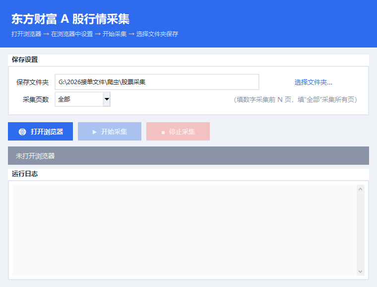
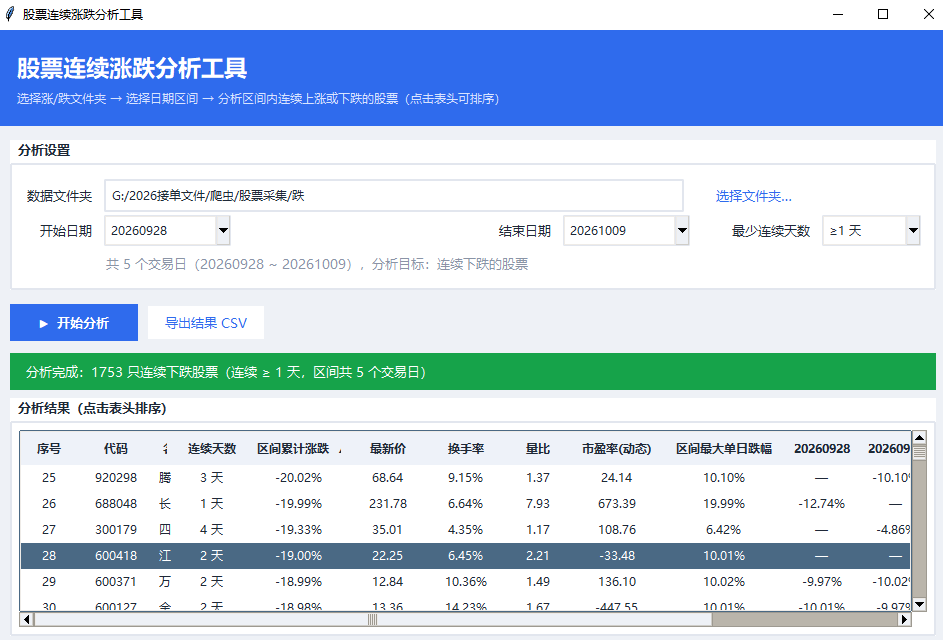

# 股票行情采集与连续涨跌分析工具

一套基于 Python 的 A 股数据小工具，包含两个图形界面程序：

| 程序 | 作用 |
| --- | --- |
| `股票数据采集界面.py` | 抓取东方财富 A 股行情数据，自动翻页并保存为 CSV |
| `股票分析工具.py` | 分析区间内连续上涨 / 连续下跌的股票，支持按连续天数筛选 |

> 免责声明：本项目仅用于学习与个人研究，数据来源于公开网页，请勿用于任何商业用途或高频抓取，遵守目标网站的服务条款。

---

## 功能特性

### 数据采集工具（`股票数据采集界面.py`）

- 一键打开 Chrome 并加载东方财富 A 股行情页
- 可在浏览器中自由设置筛选条件（如「涨跌幅 > 0」「涨跌幅 < 0」）、排序等
- 自动翻页抓取全部数据，或只抓取前 N 页
- 实时进度日志，可随时停止
- 数据自动保存为 CSV（`utf-8-sig` 编码，Excel 直接打开不乱码）

### 分析工具（`股票分析工具.py`）

- 选择「涨」或「跌」数据文件夹，选择开始 / 结束日期
- 自动计算区间内每只股票的最长连续交易日（连续上涨 / 下跌天数）
- **支持按最少连续天数筛选**（≥1 天、≥2 天……），切换筛选即时刷新，无需重新读取文件
- 统计区间累计涨跌、区间最大单日涨跌幅、最新价、换手率、量比、市盈率(动态)等
- 表头可点击排序（点一下升序、再点一下降序）
- 一键导出筛选结果为 CSV

---

## 界面截图

### 数据采集工具



### 分析工具



---

## 目录结构

```
股票采集/
├── 股票数据采集界面.py   # 数据采集工具
├── 股票分析工具.py       # 连续涨跌分析工具
├── 涨/                   # 每日上涨股票数据（文件名 YYYYMMDD.csv）
│   ├── 20260928.csv
│   └── ...
└── 跌/                   # 每日下跌股票数据（文件名 YYYYMMDD.csv）
    ├── 20260928.csv
    └── ...
```

---

## 环境要求

- Python 3.8+
- Chrome 浏览器（采集工具依赖）
- 第三方库：`DrissionPage`

## 安装

```bash
pip install DrissionPage
```

其余依赖均为 Python 标准库（`tkinter`、`csv` 等），无需额外安装。

---

## 使用方法

### 第一步：采集每日数据

1. 运行采集工具：

   ```bash
   python 股票数据采集界面.py
   ```

2. 点击「打开浏览器」，等待 Chrome 自动加载东方财富 A 股行情页。
3. 在浏览器中设置筛选条件，例如：
   - 采集**上涨**股票：把「涨跌幅」筛为大于 0
   - 采集**下跌**股票：把「涨跌幅」筛为小于 0
4. 回到程序，选择保存文件夹，设置采集页数（默认「全部」），点击「开始采集」。
5. 采集完成后，把当天生成的 `YYYYMMDD.csv` 文件手动放入 `涨/` 或 `跌/` 文件夹（根据你筛选的方向）。

> 建议每天分别采集一次「涨」「跌」两组数据，日积月累即可得到连续多日的数据，供分析工具使用。

### 第二步：分析连续涨跌

1. 运行分析工具：

   ```bash
   python 股票分析工具.py
   ```

2. 选择数据文件夹（`涨/` 或 `跌/`）。
3. 选择开始日期、结束日期。
4. 选择「最少连续天数」（≥1 天、≥2 天……）。
5. 点击「开始分析」，结果表格中「连续天数」列即为该股票在区间内的最长连续上涨 / 下跌天数。
6. 可点击表头排序，或点击「导出结果 CSV」保存筛选后的结果。

---

## 数据格式

采集工具生成的 CSV 包含以下字段：

```
代码, 名称, 最新价, 涨跌幅, 涨跌额, 成交量(手), 成交额, 振幅,
最高, 最低, 今开, 昨收, 量比, 换手率, 市盈率(动态), 5分钟涨跌
```

示例：

```
代码,名称,最新价,涨跌幅,涨跌额,成交量(手),成交额,振幅,最高,最低,今开,昨收,量比,换手率,市盈率(动态),5分钟涨跌
300530,领湃科技,28.90,20.02%,4.82,17.01万,4.69亿,13.00%,28.90,25.77,26.41,24.08,16.00,9.89%,-145.05,56.82
```

---

## 常见问题

- **打不开浏览器 / 采集失败**：确认已安装 Chrome，且 `DrissionPage` 已正确安装。
- **Excel 打开 CSV 乱码**：采集工具已使用 `utf-8-sig` 编码保存，正常情况下不会乱码。
- **分析工具提示「没有找到日期文件」**：请确认文件夹内的 CSV 文件名是 8 位数字（如 `20261009.csv`）。
- **「连续天数」表示什么**：指该股票在所选日期区间内，最长连续出现的交易日数（即最长连续上涨 / 下跌天数）。

---

## License

仅供个人学习使用。
